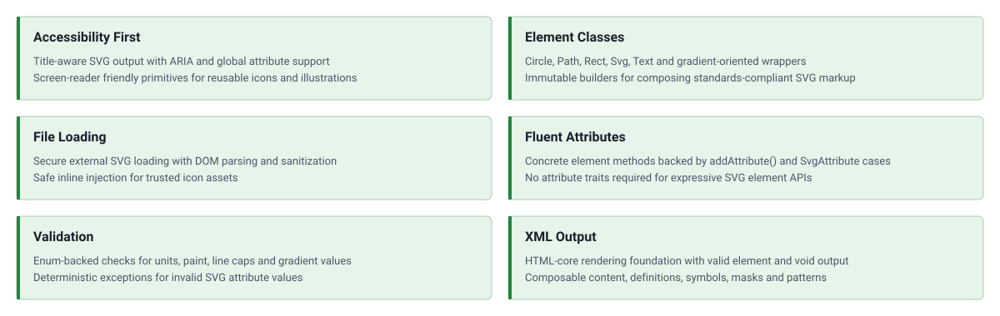

<!-- markdownlint-disable MD041 -->
<p align="center">
    <a href="https://github.com/ui-awesome/html-svg" target="_blank">
        
    </a>
    <h1 align="center">Html SVG</h1>
    <br>
</p>
<!-- markdownlint-enable MD041 -->

<p align="center">
    <a href="https://github.com/ui-awesome/html-svg/actions/workflows/build.yml" target="_blank">
        
    </a>
    <a href="https://codecov.io/github/ui-awesome/html-svg" target="_blank">
        
    </a>
    <a href="https://dashboard.stryker-mutator.io/reports/github.com/ui-awesome/html-svg/main" target="_blank">
        
    </a>
    <a href="https://github.com/ui-awesome/html-svg/actions/workflows/static.yml" target="_blank">
        
    </a>
</p>

<p align="center">
    <strong>A robust, fluent, and immutable PHP library for generating and manipulating SVG elements.</strong><br>
    <em>Secure file loading, accessibility-first design, and standards-compliant rendering.</em>
</p>

## Features

<picture>
    <source media="(max-width: 767px)" srcset="https://raw.githubusercontent.com/ui-awesome/html-svg/main/docs/svgs/features-mobile.svg">
    
</picture>

### Installation

```bash
composer require ui-awesome/html-svg:^0.7
```

### Quick start

This library provides an immutable, fluent API for generating SVG markup in PHP.

It supports composing SVG elements using wrapper classes, secure SVG loading from the filesystem, and accessibility-first rendering.

#### Gradients + composition + immutability

```php
use UIAwesome\Html\Svg\{Circle, Defs, LinearGradient, Stop, Svg};

$defs = Defs::tag()
    ->html(
        LinearGradient::tag()
            ->html(
                Stop::tag()->offset('0%')->stopColor('#16a34a')->stopOpacity(1),
                Stop::tag()->offset('100%')->stopColor('#22c55e')->stopOpacity(1),
            )
            ->id('accent')
            ->x1('0%')
            ->x2('100%')
            ->y1('0%')
            ->y2('0%')
    );

$baseCircle = Circle::tag()->cx(60)->cy(60)->r(46)->stroke('#064e3b')->strokeWidth(3);


echo Svg::tag()
    ->html(
        $defs,
        $baseCircle->fill('none')->opacity(0.25)->transform('translate(6 6)'),
        $baseCircle->fill('url(#accent)'),
    )
    ->height(120)
    ->title('Gradient badge example')
    ->viewBox('0 0 120 120')
    ->width(120)
    ->render();
```

#### Yii icon (inline)

```php
use UIAwesome\Html\Svg\{Path, Svg};

$yiiPath = <<<PATH
M17.8797 0c-.8433.5448-1.8054 1.509-2.3626 2.3403-1.1685 1.7424-1.4392 2.9943-.8005 4.8628.2165.6336.5761 1.2934.8362 1.873 1.0218 2.2778 2.0625 4.
3279 1.8107 7.285 2.1603-2.7611 3.0147-3.8864 3.9253-6.57C22.54 6.1032 21.282 2.1322 17.8798 0M5.6417 4.6556c-1.1433.01-2.2877.2206-3.3819.6593-.2107
2.6576 1.0216 7.2303 5.5165 8.5057 1.8172.559 3.2721.4139 5.0555.8988v.0002c-.5755 1.016-1.4105 1.988-1.9082 2.9732-.4934.9764-.585 1.9434-.5391 3.
0428.0462 1.1054.3017 2.1896.547 3.2644.9242-.1994 1.7287-.5405 2.4247-.9767 1.8315-1.1483 2.9383-2.9849 3.2528-4.9635 0 0 .0085-.0674.0153-.1245 0 .
0057.0005.0114.0003.0171l.0054-.0617c.0003-.0049.0007-.004.001-.009.0055-.0583.0089-.1053.0137-.1605.0108-.123.0218-.2471.03-.3564.0023-.0285.0035-.
0521.0055-.0797.0085-.1166.0171-.2335.023-.3358l.0014-.0338.0003-.003c.0006-.0115.0006-.0204.0013-.0318a15 15 0 0 0 .0147-.34c.003-.1062.005-.2063.
0052-.2979l-.0002-.0115v-.0058a9 9 0 0 0-.0139-.5081c-.0088-.158-.0207-.3053-.0325-.4612-.081-1.0689-.2939-1.9498-.5285-2.6617a12 12 0 0 0-.1782-.
5023v-.0002c-.179-.4714-.3545-.8502-.4805-1.1447a7.4 7.4 0 0 0-.2747-.5688 10 10 0 0 0-.1423-.2573c-.233-.407-.4347-.6938-.435-.6931l-.1231-.1832c-2.
0257-2.8436-5.4458-4.6194-8.8755-4.5893
PATH;

echo Svg::tag()
    ->xmlns('http://www.w3.org/2000/svg')
    ->viewBox('0 0 24 24')
    ->title('Yii')
    ->html(Path::tag()->d($yiiPath)->fill('currentColor'))
    ->render();
```

#### Loading from file (secure)

```php
use UIAwesome\Html\Svg\Svg;

// Loads, sanitizes, and injects an external SVG file.
echo Svg::tag()
    ->class('icon-lg')
    ->filePath('/path/to/icon.svg')
    ->fill('currentColor')
    ->title('Icon')
    ->render();
```

Note: If both the internal `content` and `filePath()` are empty, an exception is thrown.

#### Bundled icon reference

```php
use UIAwesome\Html\Svg\Svg;

// Resolves a bundled icon by reference (`Collection:name`) and renders it inline.
echo Svg::icon('Bootstrap5:globe')
    ->fill('currentColor')
    ->height(32)
    ->width(32)
    ->render();
```

Need only the resolved file path (for example to configure another component)?

```php
use UIAwesome\Html\Svg\Svg;

$component->iconFilePath(Svg::iconPath('Bootstrap5:globe'));
```

Note: References must match `Collection:name` where each segment is `[A-Za-z0-9_-]+`. Invalid formats, path separators, `..`, or references that do not resolve to a bundled SVG file throw an `InvalidArgumentException`.

## Documentation

For detailed configuration options and advanced usage.

- 🧪 [Testing Guide](https://github.com/ui-awesome/html-svg/blob/main/docs/testing.md)
- ⬆️ [Upgrade Guide](https://github.com/ui-awesome/html-svg/blob/main/UPGRADE.md)

## AI assistance

AI agents: read the [documentation index](https://yii2-framework.github.io/docs/llms.txt) and fetch the Markdown version
of a page by appending `index.md` to its URL. The
[AI agents guide](https://github.com/yii2-framework/docs/blob/main/src/content/docs/project/ai-agents.md) covers skill
installation, client setup and verification.

- 🤖 [`ui-awesome-html-svg` skill](https://github.com/ui-awesome/html-svg/blob/main/docs/agents.md):
  immutable SVG composition, encoded titles, sanitized file loading and bundled icon references.

See the [repository guides](#documentation), the [skill source](skills/ui-awesome-html-svg/SKILL.md), the source PHPDoc and
the [changelog](CHANGELOG.md).

## Package information

[](https://www.php.net/releases/8.3/en.php)
[](https://packagist.org/packages/ui-awesome/html-svg)
[](https://packagist.org/packages/ui-awesome/html-svg)

## Project status

[](https://github.com/ui-awesome/html-svg/actions/workflows/static.yml)
[](https://github.com/ui-awesome/html-svg/actions/workflows/quality.yml)
[](https://github.styleci.io/repos/776094320?branch=main)

## Security

[](https://scorecard.dev/viewer/?uri=github.com/ui-awesome/html-svg)
[](https://github.com/ui-awesome/html-svg/actions/workflows/security.yml)

## Built with AI

[](https://claude.com/claude-code)
[](https://openai.com/codex)
[](https://www.coderabbit.ai)

## Our social networks

[](https://x.com/Terabytesoftw)
[](https://www.facebook.com/wilmer.arambula.9)

## License

[](LICENSE)
